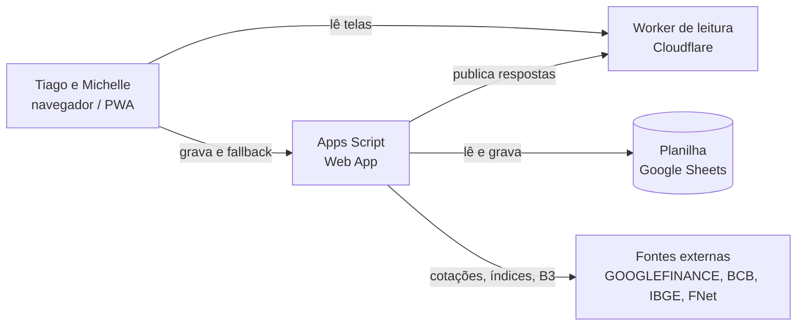
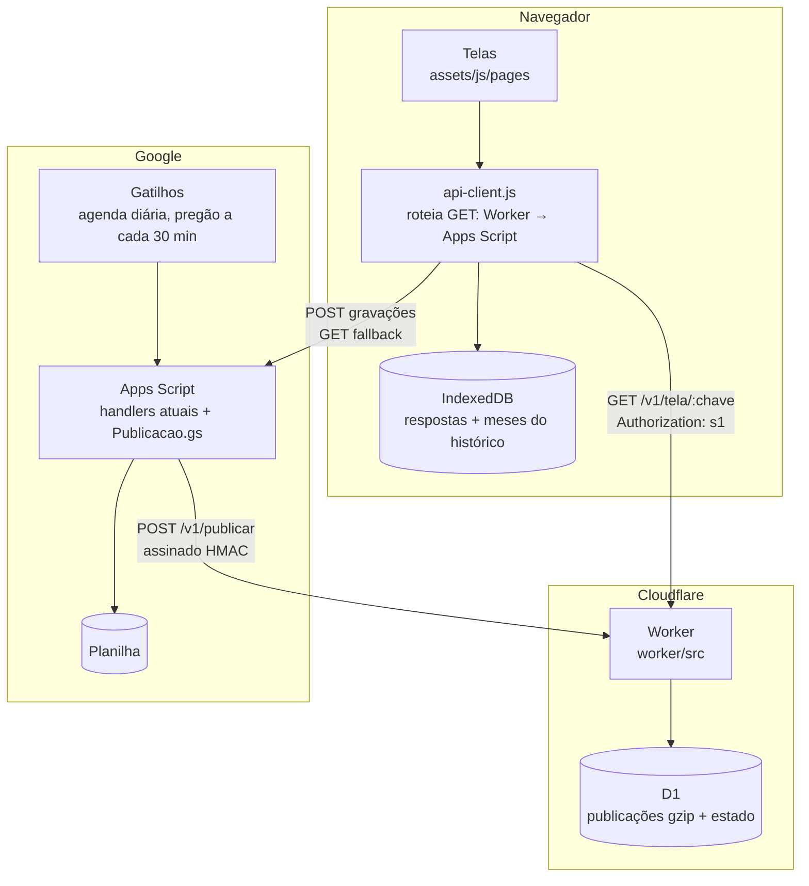
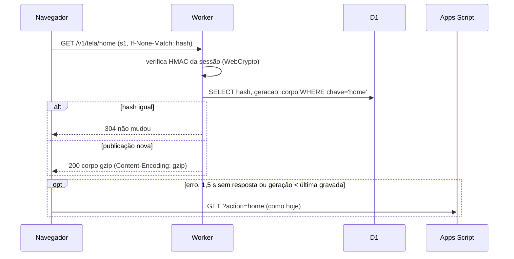
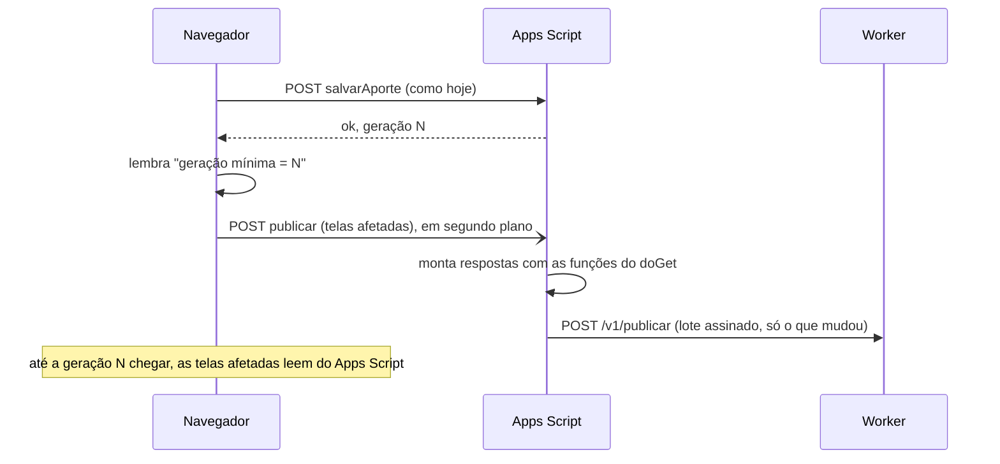

# Camada de leitura no Cloudflare (performance)

> Documento de arquitetura e plano. Pedido do Tiago (29/10/2026): "o Atualizar demora muito (até ~30 s quando o cache é de outro dia); performance vira prioridade altíssima, com muito cuidado nos cálculos e nas informações, e testes firmes".

## 1. Contexto e diagnóstico

Hoje cada leitura do site segue o caminho `navegador → Apps Script (doGet) → planilha → resposta`. A planilha faz três papéis: banco de dados, motor de cálculo e fonte de cotações (GOOGLEFINANCE).

Medido em 29/10/2026 (cópia .xlsx da planilha e harness com as fixtures):

| Fato | Valor | Consequência |
|---|---|---|
| Fórmulas na planilha | **1,18 milhão** antes da F0 (Transações/USA/RF ≈ 240-250 mil cada e `aux_tests` ≈ 259 mil, quase tudo em linha vazia; ~10 mil `HOJE()` em Proventos); **47 mil** depois (`diagnosticarFormulasPlanilhaDireto`, 29/10/2026). As DB-* são 1 IMPORTRANGE cada (os ~145 mil eram células importadas, não fórmulas) | toda leitura do Apps Script espera o recálculo |
| Cálculo das telas em Node (mesmo código .gs, dados já em memória) | Início 207 ms; demais telas 1–50 ms | **o custo não é o cálculo, é o acesso à planilha** + partida do Apps Script |
| Tamanho das respostas | `home` 1,97 MB, `historico_inicio` 1,95 MB, `transacoes` 237 KB, `proventos` 97 KB, demais < 40 KB | download e `JSON.parse` pesados no celular |
| Chamadas por tela | Início: home + patrimônio + metas + inflação + intradia + status do cabeçalho | cada uma paga a partida (1–3 s) e disputa a planilha |
| Cache de resposta no servidor | só Metas, Gastos e compras | primeira leitura do dia refaz tudo (o relato de ~30 s) |

**Conclusão:** otimizar dentro do Apps Script tem teto (segundos). A leitura precisa sair do caminho da planilha.

## 2. Decisão em uma frase

A planilha e o Apps Script continuam **gravando e calculando** (com o mesmo código de hoje). Depois de cada mudança, o Apps Script **publica as respostas prontas** em um Worker do Cloudflare, e o site passa a **ler** de lá. Se o Worker falhar ou estiver atrás, o site volta ao Apps Script, como hoje.

## 3. Escopo

**Dentro:** leituras das telas (Início, Carteiras e classes, Acompanhamento, Proventos, Metas, Organização, Transações, Detalhe do ativo por ticker, cabeçalho), publicação pelo Apps Script, autenticação, fallback, histórico incremental, medição.

**Fora (continua no Apps Script):** todas as gravações; arquivos do Drive (IR, holerites, faturas, teses); notícias, vídeos e intradia (dependem de fontes externas na hora); importações.

## 4. Requisitos

### Histórias

- **US-01:** Eu, como usuário, quero que "Atualizar" traga os números em menos de 1 segundo, para não esperar a planilha.
- **US-02:** Eu, como usuário, quero que a primeira abertura do dia seja tão rápida quanto as outras, para não depender do cache do aparelho.
- **US-03:** Eu, como usuário, quero ver os mesmos números de hoje, centavo por centavo, para confiar na troca.
- **US-04:** Eu, como usuário, quero ver o que acabei de lançar logo depois de gravar, para não ficar na dúvida se gravou.
- **US-05:** Eu, como usuário, quero que o site continue funcionando se o Cloudflare cair, para nunca ficar sem os dados.

### Requisitos funcionais

| ID | Requisito | Prioridade |
|---|---|---|
| RF-01 | O Apps Script publica no Worker a resposta de cada tela publicável, montada pelas **mesmas funções** do `doGet`. | Must |
| RF-02 | O Worker entrega a resposta publicada de uma tela, autenticada pela sessão `s1` do site. | Must |
| RF-03 | O site lê do Worker; em erro, ausência ou tempo esgotado (1,5 s), lê do Apps Script. | Must |
| RF-04 | Cada publicação carrega a **geração** da planilha (carimbo de escrita); o site não aceita publicação de geração anterior à última que ele mesmo gravou. | Must |
| RF-05 | Depois de uma gravação, o site pede a republicação das telas afetadas em segundo plano e lê do Apps Script até a geração nova chegar ao Worker. | Must |
| RF-06 | Publicação periódica no horário do pregão (dias úteis da B3), para as telas que dependem de cotação. | Must |
| RF-07 | Publicação completa logo após a agenda diária. | Must |
| RF-08 | O histórico da Início é publicado e baixado **por mês**; o aparelho só baixa os meses que mudaram. | Should |
| RF-09 | Resposta igual à que o aparelho já tem volta como "não mudou" (hash), sem corpo. | Must |
| RF-10 | O Registro de Controle mostra a saúde da camada: idade da última publicação por tela, falhas e % de leituras servidas pelo Worker. | Should |

Critérios de aceite (Dado/Quando/Então):

- **RF-01/US-03:** Dado o harness com as fixtures, quando a publicação de cada tela é montada, então o JSON descompactado é **idêntico** à resposta do `doGet` da mesma tela (ignorando só `_ms`, `_etag` e `_naoMudou`).
- **RF-02:** Dado um token `s1` válido criado pelo `Auth.gs`, quando o site pede `GET /v1/tela/home`, então o Worker responde 200 com o corpo publicado; com token vencido, adulterado ou de e-mail fora da lista, responde 401 e não revela conteúdo.
- **RF-03/US-05:** Dado o Worker fora do ar, quando a Início carrega, então os números vêm do Apps Script e a tela funciona como hoje.
- **RF-04/RF-05/US-04:** Dado que gravei um lançamento (geração N), quando abro Carteiras antes da republicação, então a tela vem do Apps Script; quando a publicação N chega, as leituras seguintes vêm do Worker.
- **RF-06:** Dado um dia útil às 11h, quando passam 30 minutos da última publicação de cotações, então uma nova publicação das telas com cotação acontece sozinha; em sábado, domingo e feriado da B3 não acontece.
- **RF-08:** Dado que o aparelho já tem os meses até setembro, quando a Início atualiza em outubro, então só o mês de outubro (e meses reprocessados por consolidação) é baixado.
- **RF-09:** Dado que nada mudou desde a última leitura, quando clico em "Atualizar", então o Worker responde "não mudou" sem corpo.

### Requisitos não funcionais

| ID | Requisito (medível) |
|---|---|
| RNF-01 | "Atualizar" de qualquer tela publicada: **p95 ≤ 1 s** de ponta a ponta no celular em 4G; mediana ≤ 400 ms. |
| RNF-02 | Tempo de servidor do Worker: p95 ≤ 50 ms (leitura de 1 linha do D1 + verificação HMAC). |
| RNF-03 | Primeira abertura do dia com cache do aparelho vazio: Início completa em ≤ 2 s. |
| RNF-04 | Corpo transferido: Início ≤ 300 KB comprimido; demais telas ≤ 100 KB. |
| RNF-05 | No pregão, a tela aberta mostra a cotação com no máximo **5 min** a mais que o GOOGLEFINANCE (que já tem ~15-20 min de atraso): mostra a última publicação na hora e, se ela tiver mais de 5 min, se atualiza sozinha com a nova (ADR-11). Sem ninguém no site, a publicação de cotação roda a cada 30 min. Toda tela de cotação diz de quando é o preço ("Cotações de HH:MM"). |
| RNF-06 | Publicação após gravação visível em ≤ 90 s; até lá a tela usa o Apps Script (sem dado velho). |
| RNF-07 | Paridade: 100% das telas publicadas idênticas ao `doGet` nos testes do harness. |
| RNF-08 | Custo: R$ 0 (planos grátis do Cloudflare e do Google). Uso diário ≤ 50% de cada cota (gatilhos do Apps Script 90 min/dia; D1 100 mil gravações/dia; Workers 100 mil requisições/dia). |
| RNF-09 | Nenhum segredo no repositório público; segredos só em Propriedades do script e `wrangler secret`. |
| RNF-10 | Disponibilidade: falha do Worker não derruba nenhuma tela (fallback automático, RF-03). |

## 5. Arquitetura

### Contexto (C4 nível 1)

### Contêineres (C4 nível 2)

### Leitura (o caminho rápido)

### Gravação e republicação

### Modelo de dados (D1)

| Tabela | Colunas | Uso |
|---|---|---|
| `publicacao` | `chave` (PK, ex.: `home`, `ativo?ticker=PETR4`, `historico_mes?m=2026-10`), `geracao`, `hash`, `publicado_em`, `bytes`, `corpo` (BLOB gzip ≤ 2 MB) | uma linha por tela publicada |
| `estado` | `chave` (PK), `valor` | geração atual, última publicação por família, contadores de saúde |

## 6. Decisões (ADRs)

**ADR-01. Camada de leitura em vez de migrar tudo.**
- **Contexto:** o gargalo é a leitura (§1), e a lógica validada (cálculos, Intelinveste, importações) vive no Apps Script e nas fórmulas.
- **Opções:** otimizar o atual; camada de leitura; migrar para banco de dados.
- **Escolha:** camada de leitura. Ganha a velocidade da migração na leitura, sem reescrever cálculos.
- **Consequência:** dados em dois lugares, resolvido pela ADR-05. Migrar as gravações fica possível depois, tela por tela.
- **Atende:** US-01, US-02, RNF-01, RNF-08.

**ADR-02. O Apps Script calcula; o Worker só entrega.**
- **Contexto:** a prioridade é cálculo idêntico (US-03).
- **Escolha:** o Worker não tem regra de negócio, só autentica e devolve o corpo publicado. Recalcular no navegador (com cotação do Yahoo, por exemplo) fica fora desta versão, porque duplicaria a lógica.
- **Consequência:** a paridade vale por construção e é conferida no harness. O frescor das cotações fica limitado à frequência de publicação (RNF-05).
- **Atende:** RF-01, RNF-07.

**ADR-03. D1 com corpo em gzip (e não KV ou R2).**
- **Contexto:** cerca de 40 chaves × ~30 publicações por dia.
- **Opções:** o KV grátis aceita 1.000 gravações por dia, o que estoura. O R2 resolve, mas vira um segundo serviço. O D1 dá 100 mil linhas por dia e 2 MB por linha.
- **Escolha:** D1, com o corpo comprimido no Apps Script (`Utilities.gzip`) e servido como `Content-Encoding: gzip`, sem descomprimir no Worker (CPU ≈ 0 no limite de 10 ms do plano grátis). Só grava a chave cujo hash mudou.
- **Atende:** RNF-02, RNF-04, RNF-08.

**ADR-04. Cotações pela planilha, sem fonte nova.**
- **Escolha:** os preços continuam vindo do GOOGLEFINANCE. A frequência começa em 30 min no pregão (a 1ª publicação completa levou ~2,5 min) e cai para 15 min depois da F0, conforme a medição da cota de gatilhos. A brapi segue só nos proventos. O Yahoo, como reforço no "Atualizar", fica para uma fase opcional, junto com o recálculo no navegador (ADR-02).
- **Atende:** RNF-05, RNF-08.

**ADR-05. Consistência pela geração da planilha.**
- **Escolha:** cada publicação leva o carimbo de escrita (`carimboEscritaPlanilha_`) da execução que a montou. Depois de gravar, o navegador guarda a geração devolvida e não aceita publicação mais antiga (RF-04). Assim nunca aparece dado anterior a uma gravação do próprio usuário.
- **Atende:** US-04, RNF-06.

**ADR-06. Autenticação reaproveitando a sessão `s1`.**
- **Escolha:** o Worker verifica o mesmo token HMAC-SHA256 do `Auth.gs` (WebCrypto), com o mesmo segredo guardado como `wrangler secret`, e confere a lista de e-mails. A publicação usa outro segredo (assinatura HMAC do corpo, com carimbo de tempo contra repetição). O token vai no cabeçalho `Authorization`, e não na URL, com `Access-Control-Max-Age` para evitar a pré-checagem do CORS a cada pedido.
- **Atende:** RF-02, RNF-09.

**ADR-07. Histórico da Início por mês.**
- **Contexto:** a série diária é cerca de 2 MB e quase toda imutável.
- **Escolha:** publicar um bloco por mês, com hash próprio. O aparelho guarda os meses e baixa só os que mudaram (mês corrente e meses reprocessados por consolidação).
- **Atende:** RF-08, RNF-03, RNF-04.

**ADR-08. Emagrecer a planilha (independente da camada).**
- **Escolha:** remover `aux_tests` e as fórmulas pré-preenchidas das linhas vazias das Transações (uma fórmula por coluna), e tirar o `HOJE()` das abas de Proventos. Tudo com backup antes.
- **Consequência:** acelera gravação, sincronização e publicação, que continuam passando pela planilha. Medido antes e depois.
- **Atende:** RNF-06, RNF-08.

**ADR-09. Gráfico do dia direto do Yahoo pelo Worker.**
- **Contexto:** o intradia não vem da planilha (Intradia.gs lê o Yahoo). Pelo Apps Script, os pedidos entram em fila: 2 a 12 s para 150 ms de servidor.
- **Escolha:** `GET /v1/intradia` no Worker, com a mesma conta do Intradia.gs (`assets/js/intradia-yahoo.js`, conferida nos dois lados) e 5 min de memória. Até 15 símbolos por pedido, por causa dos 10 ms de CPU. O que o Yahoo não responder lá (`falhas`) vai ao Apps Script; se ele recusar tudo, o site para de tentar o Worker por 30 min.
- **Consequência:** é a única leitura que não vem da planilha publicada. Só o desenho do dia sai daqui; cotação e variação da tela continuam as da planilha.
- **Atende:** RNF-01.

**ADR-10. Cada gravação invalida só as telas que muda.**
- **Contexto:** qualquer gravação fazia o aparelho recusar todo o Worker até a próxima publicação. Salvar favoritos deixava a Início 30 a 40 s no Apps Script.
- **Escolha:** `ESCOPO_GRAVACAO` (api-client.js) lista as telas afetadas por gravação. O padrão é todas: a planilha liga as abas por fórmula. Só entram gravações em abas que apenas o Apps Script lê (`aux_gastos*`) ou que não são publicadas. Favoritos: a Início publicada continua valendo, com a lista salva no aparelho por cima, até a publicação nova. A republicação pedida também se limita a essas telas.
- **Atende:** RF-05, RNF-01.

**ADR-11. Cotação de agora ao entrar no site.**
- **Contexto:** a cópia publicada pode ter até 30 min, e um gatilho de 15 min arrisca a cota diária de gatilhos do Apps Script (~90 min/dia na conta grátis), que também roda a agenda.
- **Escolha:** cada tela de cotação lida do Worker traz a geração (o início da montagem). Se ela tiver mais de 5 min no pregão, o site mostra a cópia na hora e pede `publicarLeitura&familias=cotacao&seMaisVelhaQueMin=5`. É uma execução do Web App, fora da cota de gatilhos. O Apps Script só publica no pregão e se a última montagem de cotação (`LEITURA_COTACAO_EM`) tiver mais de 5 min: vários aparelhos ou telas pedindo juntos dão uma publicação só. Quando ela termina, o site dispara `investiments:leitura-atualizada` e o "Atualizar dados" de cada tela busca de novo. O botão mostra "Cotações de HH:MM" quando o preço na tela tem mais de 2 min. O gatilho do pregão continua em 30 min.
- **Atende:** RNF-05.

## 7. Estratégia de testes

| Camada | O que garante | Como |
|---|---|---|
| **Paridade** (harness) | publicação = `doGet`, tela por tela | `tests/harness/publicacao-paridade.test.js`: monta cada família com as fixtures, descomprime e compara com o handler (`deepEqual`, sem `_ms`/`_etag`) |
| **Contrato de rotas** | nenhuma tela nova fica fora sem querer | todo GET do `Router.gs` está classificado como "publicada" ou "só Apps Script"; ação nova sem classificação falha |
| **Autenticação cruzada** | o Worker aceita só o que o Apps Script emite | token criado pelo `criarTokenSessao_` no sandbox é verificado pelo módulo do Worker; vencido, adulterado e e-mail fora da lista recusados |
| **Worker** | rotas, 304, gzip, assinatura da publicação, carimbo de tempo, limites | `node --test` com o Worker em módulos puros e D1 emulado em `node:sqlite` (sem dependência nova) |
| **Publicação** | só grava o que mudou; lote dentro de 2 MB por linha; gatilho respeita pregão e feriados | testes do `Publicacao.gs` no harness, como `agenda-diaria.test.js` |
| **Front** | roteamento, fallback em 1,5 s, geração mínima depois de gravar, meses do histórico | `api-client` e Início em jsdom (padrão atual) |
| **Orçamento** | RNF-04 | teto de bytes por família no harness, como `carga-telas.test.js` |
| **Desempenho real** | RNF-01, RNF-02 | `scripts/medir-worker.mjs`: p50/p95 do Worker publicado e do Apps Script, antes e depois; resultado no histórico do projeto |

Todo bug achado ganha teste, como hoje. O pre-commit roda as camadas acima.

## 8. Plano por fases

| Fase | Entrega | Critério de saída |
|---|---|---|
| **F0. Medir e emagrecer** | tempos por etapa no servidor (abrir planilha, ler abas, montar); números atuais do aparelho; backup + ADR-08 | baseline registrado; planilha sem `aux_tests` e sem fórmulas em linhas vazias; tempo do `doGet` medido de novo |
| **F1. Worker** | projeto `worker/` (wrangler, D1, rotas `/v1/tela/:chave` e `/v1/publicar`, autenticação), deploy em `workers.dev` | testes de Worker e de autenticação cruzada passando; p95 do servidor ≤ 50 ms |
| **F2. Publicação** | `Publicacao.gs` (famílias, hash, gzip, lote assinado), etapa na agenda, gatilho do pregão, ação `publicar` | paridade 100%; cotas medidas ≤ 50% |
| **F3. Início no Worker** | `api-client` com roteamento, fallback e geração; Início lendo do Worker | RNF-01 e RNF-03 medidos na Início |
| **F4. Demais telas** | Carteiras, Acompanhamento, Proventos, Metas, Organização, Transações, ativo por ticker, cabeçalho; histórico por mês (ADR-07) | todas as telas publicadas no orçamento (RNF-04) |
| **F5. Observabilidade** | saúde da camada no Registro de Controle (RF-10) | idade e falhas visíveis; aviso se a publicação parar |
| F6 (opcional) | cotação do Yahoo no "Atualizar" com recálculo compartilhado e testado; gravações no Worker | decisão depois de F5 |

## 9. Riscos

| Risco | Mitigação |
|---|---|
| Cota de gatilhos do Apps Script (90 min/dia) | medir em F0/F2; frequência ajustável; só republica famílias com cotação no pregão |
| Publicação parar sem ninguém ver | RF-10 + fallback por geração; aviso no cabeçalho |
| Vazamento de segredo (repositório público) | segredos só em Propriedades e `wrangler secret`; teste que procura segredo no repositório |
| Corpo acima de 2 MB numa linha do D1 | gzip + histórico por mês; teste de orçamento |
| Dois lugares com o mesmo dado | o Apps Script é o único que grava; geração em toda publicação |
