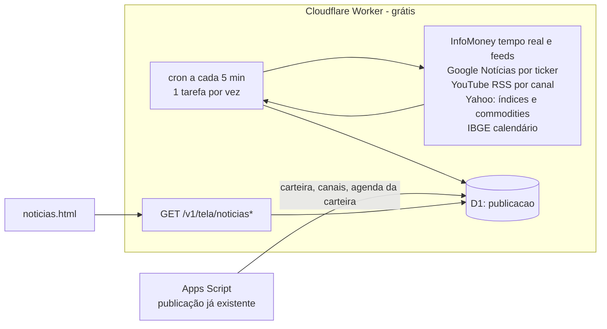

# Tela de Notícias

Nova tela no menu principal (depois de Metas). Design: canvas "Tela de Notícias" (computador e celular). Tudo grátis (Cloudflare Workers Free + Apps Script) e sem o Apps Script no caminho da leitura.

## 1. Histórias de usuário

- **HU-01.** Eu, como usuário, quero ver na hora como está a bolsa (Ibovespa por padrão, IFIX, exterior e dólar), com o gráfico do dia e o tempo real, para saber o que está mexendo com o mercado agora.
- **HU-02.** Eu, como usuário, quero as notícias de cada um dos meus ativos, filtrando por classe ou por ativo, para acompanhar o que importa para a minha carteira.
- **HU-03.** Eu, como usuário, quero os últimos vídeos dos canais que eu sigo (UOL, especialistas e os da carteira), para me atualizar sem abrir o YouTube.
- **HU-05.** Eu, como usuário, quero ver os possíveis fatores de um ativo meu estar subindo ou caindo hoje, para entender o movimento sem ler todas as notícias.
- **HU-04.** Eu, como usuário, quero uma agenda do dia e da semana (meus proventos, vencimentos, resultados, indicadores e Copom), para me preparar.

## 2. Requisitos funcionais

| ID | Prioridade | Requisito |
|---|---|---|
| RF-01 | Must | Índices em botões: Ibovespa (padrão), IFIX, Exterior (S&P 500), Dólar. Cada um com valor, variação, gráfico do dia, abertura, máxima e mínima. |
| RF-02 | Must | Tempo real: o Ibovespa lê o tempo real do InfoMoney do dia inteiro; IFIX, Exterior e Dólar leem as atualizações dele sobre o assunto, completadas pelas notícias das últimas 12 h (Google Notícias). Cada item tem hora e título, com link para a fonte. |
| RF-03 | Must | "O que mexe com a bolsa": petróleo Brent, minério de ferro, ouro, Bitcoin e juro de 10 anos dos EUA, com a variação do dia. |
| RF-04 | Must | Vídeos em carrossel (rola para o lado ou 4 por página), com as abas UOL (últimos vídeos postados), Especialistas e Meus canais. O player só carrega ao clicar. |
| RF-05 | Must | Manchetes ligadas ao índice escolhido: uma matéria grande e a lista "Mais recentes". |
| RF-06 | Must | Agenda (Hoje/Semana): proventos da carteira (data-com e pagamento, com valor), vencimentos de renda fixa, fatos relevantes e emissões dos FIIs da carteira, resultados das empresas da carteira, indicadores (IBGE), Copom e Focus, e eventos dos EUA (payroll, CPI, Fed). |
| RF-07 | Must | Notícias dos ativos: todos da carteira por padrão. Filtro por classe (o IFIX filtra FIIs e o Exterior filtra EUA) e por ticker. Ordenação: recentes, posição ou variação. |
| RF-09 | Should | "Possíveis fatores hoje" ao escolher um ativo: lista ordenada por peso (forte, médio ou fraco) com o sinal de cada fator (+, − ou =). Fatores medidos: o mercado (o ativo contra o índice), o setor ou a commodity ligada, a data-com de ontem e a variação do dólar (EUA). Também as notícias do dia classificadas por tema e tom. Termina com um resumo de uma frase e o aviso "não é recomendação nem certeza de causa". |
| RF-08 | Should | No pregão, a tela se atualiza sozinha a cada 2 min enquanto está aberta e à vista. |

Critérios de aceite (exemplos):
- **RF-02.** Dado o pregão aberto, quando o InfoMoney publica uma atualização, então ela aparece na tela em até 6 min. Dado que a página do dia muda de formato ou sai do ar, quando a tela abre, então aparece a última leitura boa com um aviso, e as outras partes da tela continuam.
- **RF-04.** Dado um canal novo na aba de canais da planilha, quando a próxima publicação roda, então os vídeos dele aparecem na aba do tipo cadastrado.
- **RF-09.** Dado um FII com data-com ontem de R$ 0,80 e a cota caindo R$ 0,78 hoje, quando escolho o FII, então o primeiro fator é "data-com ontem" com peso forte. Dado um ativo sem notícia no dia e andando junto com o índice, então o resumo diz que ele acompanhou o mercado.
- **RF-06.** Dado um provento da carteira com data-com hoje, quando a tela abre, então ele aparece em "Hoje" com o selo "na sua carteira" e o valor.

## 3. Requisitos não funcionais

| ID | Requisito |
|---|---|
| RNF-01 | Abertura: o cache do aparelho pinta em menos de 300 ms; os dados novos chegam do Worker em menos de 800 ms (p95). Nenhuma leitura da tela passa pelo Apps Script. |
| RNF-02 | Frescor no pregão: tempo real em até 5 min; índices e commodities em até 5 min; notícias dos ativos em até 30 min; vídeos em até 30 min. Fora do pregão: até 2 h. |
| RNF-03 | Custo zero: dentro do Workers Free (10 ms de CPU por execução, 50 pedidos externos por execução, 5 crons por conta, 100 mil requisições/dia) e do D1 grátis. Não gasta a cota de gatilhos do Apps Script. |
| RNF-04 | Peso: a tela baixa no máximo 120 KB de JS próprio; imagens com `loading="lazy"`; player do YouTube só ao clicar. |
| RNF-05 | Resiliência: uma fonte fora do ar esconde só a sua parte, com aviso. O resto da tela continua. |
| RNF-06 | Saúde: o popover do Registro de Controle mostra a última coleta do cron e as falhas dela; no pregão, mais de 12 min sem coleta (fora, 40 min) fica em atenção. |

## 4. Arquitetura

**Módulos:**
- `worker/src/noticias/fontes.js`: leitura das fontes (InfoMoney tempo real, RSS, feed do YouTube), sem rede.
- `worker/src/noticias/coleta.js`: o agendador (`tarefasDoDisparo`), a coleta e a montagem das telas; chamado pelo `scheduled` de `worker/src/index.js`.
- `apps-script/Noticias.gs`: publica `noticiasConfig` (canais da aba `aux_videos-canais` com a coluna D "Tela de notícias", e os ativos com posição) e `noticiasGoogle` (ADR-N8).
- `noticias/index.html`, `assets/js/pages/noticias.js` (tela) e `noticias-calc.js` (fatores, agenda, feed e classificador, puros).
- Índices e "O que mexe com a bolsa" usam o `GET /v1/intradia` que já existia (Yahoo pelo Worker), com as chaves novas BRENT, MINERIO, OURO, BTC e US10Y.
- Agenda: proventos da tela Proventos e vencimentos da Carteira Renda Fixa (já publicadas), o calendário do IBGE (`noticiasAgenda`, lido pelo cron 1x por dia) e as datas fixas de `noticias-calc.js!EVENTOS_MERCADO`.

**Dados:** as mesmas linhas `publicacao` do D1, com chaves novas: `noticiasMercado?indice=ibov|ifix|spx|dolar`, `noticiasVideos?aba=noticias|especialistas|meus`, `noticiasAtivos`, `noticiasAgenda`. Cada linha guarda o JSON em gzip, o hash e a geração (`noticias.<ms>`); o Worker responde com ETag e 304. O que cada fonte trouxe por último fica na tabela `noticias_fonte` (o cron cria se faltar). Saúde: `estado.noticias_ultima` (tarefas, telas gravadas e falhas do último disparo), lido pelo `GET /v1/estado`.

## 5. Decisões (ADRs)

**ADR-N1. O Worker busca as fontes, não o Apps Script.**
Fetch e parse são leves: XML de RSS e uma página. O Worker faz isso em ~300 ms, perto do usuário, sem gastar os ~90 min/dia de gatilhos do Apps Script. O Apps Script só publica o que vem da planilha: tickers da carteira, canais da aba de canais e a agenda da carteira.

**ADR-N2. Um cron só, uma fatia por disparo.**
O plano grátis dá 10 ms de CPU por execução. Cada disparo (a cada 5 min) faz uma fatia:
- no pregão: tempo real em todo disparo; nos pares, as manchetes dos 4 índices; nos ímpares, 5 canais (em fila) e as notícias dos ativos (ambas do `noticiasGoogle`, ADR-N8);
- fora do pregão: cada fatia a cada 30 min.

Índices e commodities não passam pelo cron: a tela pede o gráfico do dia ao `/v1/intradia`. A leitura usa expressões simples sobre o texto (a página de ~700 KB do tempo real é lida em menos de 8 ms em Node, testado). Só vão ao D1 as telas cujo hash mudou. Usa 1 dos 5 crons da conta.

**ADR-N3. Tempo real do InfoMoney pelo endereço do dia; manchetes pelo Google Notícias.**
O endereço é `…/mercados/ibovespa-hoje-bolsa-de-valores-ao-vivo-DDMMAAAA/` e a página lista atualizações com hora e título. Guardamos hora, título e link; o corpo não. Se a página do dia não existir (antes da abertura, fim de semana) ou mudar de formato, fica a última leitura boa com aviso, e a falha vai para `estado.noticias_ultima`. Os feeds de seção do InfoMoney (`/mercados/feed/`) vêm vazios, por isso as manchetes de cada índice e as notícias dos ativos vêm da busca RSS do Google Notícias. Site pessoal e fechado.

**ADR-N8. Google Notícias pelo Apps Script.**
- **Contexto:** o Google Notícias recusa os pedidos vindos do Cloudflare (503 e sem resposta em todos os disparos de 30/10/2026).
- **Escolha:** o Apps Script busca (`Noticias.gs!noticiasGoogle_`): manchetes dos 4 índices (24 h, cache de 20 min) e as notícias de cada ativo com posição (60 dias, o mesmo cache de 2 h da tela do ativo), num `fetchAll` só, e publica `noticiasGoogle` junto das cotações (a cada 30 min no pregão; fora dele, na publicação diária). O cron do Worker só junta nas telas.
- **Consequência:** a tela do ativo e a de Notícias dividem o cache; custa poucos segundos por publicação de cotação. Fora do pregão as manchetes podem ter até 1 dia.

**ADR-N4. Vídeos pelo RSS de cada canal.**
`youtube.com/feeds/videos.xml?channel_id=…` é grátis, sem chave e devolve os 15 últimos vídeos. A UOL entra pelos últimos vídeos postados, não por playlist. A aba de canais da planilha ganha a coluna D "Tela de notícias" (noticias, especialistas, meus ou não). Vazia: @infomoney e @uol vão para Notícias, @ProfessorBaroni e @josekoborioficial para Especialistas, o resto para Meus canais. No máximo 6 vídeos de um canal por aba. O Apps Script já resolve `@nome` em id (`resolverCanalYoutube_`).

**ADR-N5. Agenda em três fontes.**
- Da carteira, das telas já publicadas: proventos (data-com e pagamento) e vencimentos de renda fixa, com o selo "na sua carteira".
- IBGE: a API pública de calendário (`servicodados.ibge.gov.br/api/v3/calendario/{produto}`), 1 leitura por dia pelo cron, só das pesquisas que mexem com o mercado (IPCA, IPCA-15, PIB trimestral, PNAD, PMC, PMS e PIM). A API dá a hora em UTC; a tela mostra a de São Paulo. Falha: fica a leitura anterior.
- Datas fixas em `noticias-calc.js!EVENTOS_MERCADO`: Copom e Fed (calendários oficiais de 2026), payroll e CPI dos EUA (calendário do BLS de 2026) e feriados da B3. O Focus entra toda segunda. Atualizar a lista na virada do ano.

Fora por enquanto: resultados das empresas da carteira (nenhuma fonte aberta com a data antes da divulgação; a notícia do resultado já entra pelos fatores e pelo feed).

**ADR-N6. Notícias não esperam gravação.**
A geração mínima (ADR-10) não vale para as chaves `noticias*`, porque nenhuma gravação do site muda notícia. A única exceção é a agenda da carteira, que segue a regra normal.

**ADR-N7. "Por que sobe ou cai": algoritmo primeiro, IA só para escrever a frase.**
- **Contexto:** atribuir causa a um movimento de preço é incerto, e um modelo de linguagem solto inventa causas.
- **Escolha, em duas camadas:**
  1. **Fatores medidos (determinístico, grátis, testável).** Calculados no Worker com os dados que já temos:
     - mercado: a variação do ativo contra a do índice da classe; se a diferença for menor que 0,5 p.p., o fator é "acompanhou o mercado";
     - setor ou commodity: um mapa ativo→fator mantido no repositório (PETR4→Brent, VALE3→minério, bancos→juros, FIIs de tijolo→juros longos, EUA→S&P 500 e dólar), com a correlação de 12 meses calculada no Apps Script uma vez por dia a partir do histórico da planilha;
     - data-com de ontem, com o valor do provento;
     - fato relevante do FNet no dia.

     As notícias das últimas 24 h passam por um classificador de palavras-chave em português, com tema (resultado, dividendos, recomendação, fato relevante, política, setor, macro) e tom (positivo, negativo ou neutro), e entram como fatores. O peso combina o tamanho do movimento explicado com o tom e a recência da notícia.
  2. **Resumo em uma frase:** montado por regra a partir do fator de maior peso (`noticias-calc.js!possiveisFatores`). **Workers AI não é usado por agora** (decisão do Tiago, 30/10/2026). Se um dia entrar, recebe só os fatores da camada 1, para ativos com movimento acima de 2%, 1 vez por ativo por dia.
- **Consequência:** funciona e é testável sem IA. Fatores medidos hoje: mercado (ativo x índice da classe), commodity ligada (mapa ticker/setor → Brent, minério ou ouro), data-com no dia útil anterior, dólar (EUA) e as notícias das últimas 24 h. A correlação de 12 meses não entra: exigiria o histórico diário das commodities, que a planilha não guarda; o mapa ticker/setor cobre os casos fortes (petróleo e minério). A tela sempre diz "possíveis fatores".
- **Atende:** RF-09.

## 6. Plano de entrega

| Fase | Entrega | Pronto quando |
|---|---|---|
| N1 | Tela, menu e "Mercado hoje" (índices, gráfico, tempo real e commodities) | RF-01, RF-02, RF-03; RNF-01 medido |
| N2 | Vídeos (coluna "tipo" e carrossel) | RF-04 |
| N3 | Manchetes e notícias dos ativos | RF-05, RF-07 |
| N4 | Agenda (carteira, IBGE e datas fixas) | RF-06 |
| N4b | Possíveis fatores (camada 1; sem IA) | RF-09 |
| N5 | Atualização automática e saúde da leitura das fontes novas | RF-08, RNF-05 |

Testes:
- `tests/worker-noticias.test.js`: leitura de cada fonte com HTML e XML sintéticos, o agendador, a coleta gravando no D1 só o que mudou, fonte fora do ar, o cron, o tempo de CPU (mediana abaixo de 8 ms) e o site lendo do Worker sem Apps Script;
- `tests/noticias.test.js`: fatores (critérios do RF-09), agenda (RF-06), feed (RF-07) e a tela no JSDOM (troca de índice, player no clique, fonte fora do ar);
- `tests/leitura-saude.test.js`: a coleta do cron na saúde da leitura (RNF-06).

Implantação: `cd worker && npx wrangler deploy` (o cron entra junto). Na planilha, opcional: `configurarNoticiasDireto()` põe o título da coluna D em `aux_videos-canais`; a próxima publicação completa leva os canais e os ativos ao Worker.
